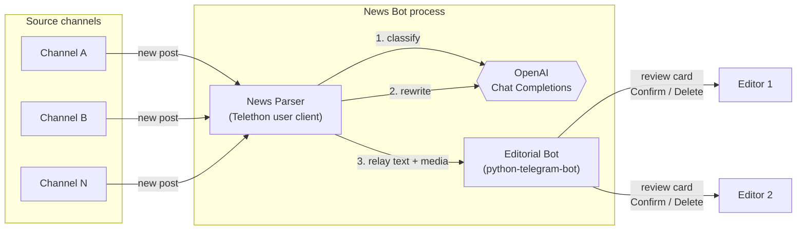

# News Bot

**AI-assisted news curation pipeline for Telegram.**

In production since 2024 for a client's editorial team. The production deployment runs from a private repo; this is the cleaned-up public version.

News Bot monitors a configurable set of Telegram channels in real time, uses an OpenAI language model to classify each post and filter out advertising, rewrites the remaining content into original copy that keeps the meaning (and direct quotations) intact, and delivers the result, together with the original media, to a team of editors. Editors review every item inside Telegram and approve or discard it with one tap.

The system is a human-in-the-loop content pipeline: AI handles the high-volume, repetitive work (screening and rewriting), while editorial decisions stay with people.

---

## Table of Contents

- [Key Features](#key-features)
- [How It Works](#how-it-works)
- [Technology Stack](#technology-stack)
- [Quick Start](#quick-start)
- [Configuration](#configuration)
- [Project Structure](#project-structure)
- [Testing](#testing)
- [Documentation](#documentation)
- [Roadmap](#roadmap)

---

## Key Features

| Area                  | Capability                                                                                                    |
| --------------------- | ------------------------------------------------------------------------------------------------------------- |
| Real-time ingestion   | Listens to any number of Telegram channels via the MTProto user API; no polling and no admin rights required. |
| AI classification     | Labels each post as `News`, `Opinion`, or `Advert`; advertising is discarded before it reaches editors.       |
| AI rewriting          | Deep rewrite that preserves meaning and verbatim quotations and keeps the source language.                    |
| Media preservation    | Photos, videos, and documents attached to the source post are forwarded together with the rewritten text.     |
| Editorial review      | Each item is delivered to every configured editor with inline **Confirm** and **Delete** actions.            |
| Cost control          | Built-in request and token budget (per minute and per day) for the OpenAI API.                                |
| Graceful degradation  | If the AI step fails or the budget runs out, the pipeline keeps running and forwards content unmodified.      |
| Operations            | Environment-driven configuration, structured logging, graceful shutdown, Docker image, and Compose stack with resource limits. |

## How It Works



1. **Ingest.** A Telethon client, authenticated as a regular Telegram account, subscribes to `NewMessage` events from the configured channels.
2. **Classify.** The post text is sent to the model with a constrained, single-word classification prompt. Posts labelled `Advert` are dropped.
3. **Rewrite.** The remaining posts are rewritten with a second prompt that preserves meaning, direct quotes, and the original language.
4. **Relay.** The user client sends the rewritten text, with the original media attached, to the editorial bot in a private chat.
5. **Distribute and review.** The bot recognises the relay account by its user ID and copies the item to every editor as a review card with inline actions.

A detailed walkthrough, including sequence diagrams and design rationale, is available in [docs/ARCHITECTURE.md](docs/ARCHITECTURE.md).

## Technology Stack

| Layer               | Technology                                                                |
| ------------------- | ------------------------------------------------------------------------- |
| Language / runtime  | Python 3.8+ (`asyncio`); container image based on Python 3.11             |
| Channel ingestion   | [Telethon](https://github.com/LonamiWebs/Telethon) (Telegram MTProto API) |
| Bot interface       | [python-telegram-bot](https://python-telegram-bot.org/) v20+ (Bot API)    |
| AI                  | [OpenAI Python SDK](https://github.com/openai/openai-python) v1+, Chat Completions API, `gpt-3.5-turbo` by default (configurable) |
| Configuration       | Environment variables (optionally from `.env` via python-dotenv) mapped to typed `dataclasses` |
| Testing             | pytest, pytest-asyncio, pytest-cov, `unittest.mock`                       |
| Packaging / deploy  | `pyproject.toml` (setuptools), Docker, Docker Compose                     |

The full breakdown, with the role of each dependency and the reasons it was chosen, is in [docs/TECH_STACK.md](docs/TECH_STACK.md).

## Quick Start

### Prerequisites

- Python 3.8 or newer (or Docker)
- Telegram API credentials (`api_id`, `api_hash`) from [my.telegram.org](https://my.telegram.org/apps)
- A bot token from [@BotFather](https://t.me/BotFather)
- An OpenAI API key from [platform.openai.com](https://platform.openai.com/api-keys)

### Run locally

```bash
git clone https://github.com/n0ah-n0wa/news_bot.git
cd news_bot

python -m venv .venv
source .venv/bin/activate            # Windows: .venv\Scripts\activate

pip install -e ".[dev]"

cp .env.example .env                 # then fill in your credentials

python -m src.main
```

`.env` in the working directory is loaded automatically. On the first launch Telethon asks for the phone number and login code of the account that reads the channels. The session is saved to `sessions/` and reused on subsequent runs. Stop the application with `Ctrl+C`.

### Run with Docker Compose

```bash
cp .env.example .env                 # then fill in your credentials
docker compose run --rm news-bot     # first run only: interactive Telegram login
docker compose up -d --build
docker compose logs -f news-bot
```

See [docs/DEPLOYMENT.md](docs/DEPLOYMENT.md) for volume permissions, log persistence, and operational guidance.

## Configuration

All settings come from environment variables; a `.env` file in the working directory is loaded automatically. The most important ones:

| Variable                 | Purpose                                                          |
| ------------------------ | ---------------------------------------------------------------- |
| `TELEGRAM_API_ID` / `TELEGRAM_API_HASH` | MTProto credentials of the account that reads the channels |
| `TELEGRAM_BOT_TOKEN`     | Token of the editorial bot                                       |
| `TELEGRAM_BOT_USERNAME`  | Username of the editorial bot, used as the relay target          |
| `TELEGRAM_NEWS_BOT_ID`   | Numeric user ID of the relay account, trusted by the bot         |
| `TELEGRAM_CHANNEL_IDS`   | Comma-separated source channels (`@username` or `-100…` IDs)     |
| `TELEGRAM_USER_CHAT_IDS` | Comma-separated list of editor chat IDs                          |
| `OPENAI_API_KEY`         | OpenAI API key                                                   |
| `OPENAI_MODEL`           | Chat model (default `gpt-3.5-turbo`)                             |

The complete reference, with defaults and instructions for obtaining each value, is in [docs/CONFIGURATION.md](docs/CONFIGURATION.md).

## Project Structure

```
news_bot/
├── src/
│   ├── main.py                 # Application orchestrator: setup, lifecycle, graceful shutdown
│   ├── core/
│   │   ├── config.py           # Typed configuration (dataclasses) loaded from the environment
│   │   └── logger.py           # Logging setup and LoggerMixin
│   ├── news_parser/
│   │   └── news_bot.py         # Telethon listener, AI classification and rewriting, RateLimiter, relay
│   └── bot/
│       └── telegram_bot.py     # Editorial bot: fan-out, inline actions, commands, MessageTracker
├── tests/
│   ├── conftest.py             # Test path setup
│   └── test_sample.py          # Unit tests for config, logging, rate limiter, parser, bot, and lifecycle
├── docs/                       # Project documentation
├── .env.example                # Configuration template
├── pyproject.toml              # Package metadata and dependency groups
├── requirements.txt            # Runtime dependencies
├── Dockerfile                  # Container image (non-root user)
└── docker-compose.yml          # Single-service stack with volumes and resource limits
```

## Testing

```bash
pip install -e ".[test]"
pytest                                  # run the suite
pytest -v --cov=src --cov-report=html   # with coverage report
```

External services (Telegram and OpenAI) are mocked, so the suite runs offline and needs no credentials. See [docs/DEVELOPMENT.md](docs/DEVELOPMENT.md) for the testing approach and contribution workflow.

## Documentation

| Document                                         | Contents                                                                   |
| ------------------------------------------------ | -------------------------------------------------------------------------- |
| [Architecture](docs/ARCHITECTURE.md)             | Components, data flow, sequence diagrams, concurrency model, design decisions |
| [Technology Stack](docs/TECH_STACK.md)           | Every library and service used, and why                                    |
| [AI Processing](docs/AI_PROCESSING.md)           | Prompt design, model parameters, rate limiting, failure strategy           |
| [Configuration](docs/CONFIGURATION.md)           | Full environment variable reference and credential setup                   |
| [Deployment](docs/DEPLOYMENT.md)                 | Local and containerised deployment, authentication, operations             |
| [Development](docs/DEVELOPMENT.md)               | Local setup, testing strategy, code conventions, extension points          |
| [Changelog](CHANGELOG.md)                        | Project history and notable changes                                        |

## Roadmap

- Persist review state and an audit trail in a database (SQLite or PostgreSQL) instead of process memory.
- Publish approved items to target channels automatically on **Confirm**.
- Add editor actions explored in earlier iterations: in-place editing by reply, expansion into long-form articles, on-demand article generation, and machine translation.
- Move to the asynchronous OpenAI client and structured (JSON) model outputs.
- Add duplicate detection across sources.

Known limitations and the reasoning behind current trade-offs are listed in [docs/ARCHITECTURE.md](docs/ARCHITECTURE.md#known-limitations).
