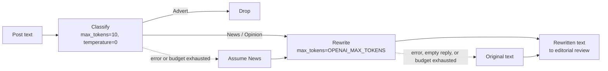
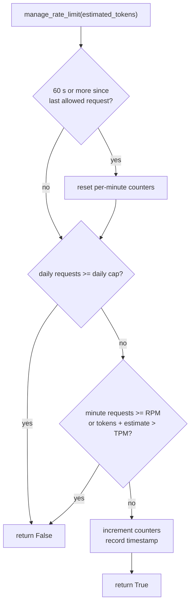

# AI Processing

This document covers the language-model part of News Bot: which tasks the model performs, how the prompts are built, which parameters are used, how usage is budgeted, and what happens when something goes wrong.

All AI logic lives in `src/news_parser/news_bot.py`.

- [Pipeline Overview](#pipeline-overview)
- [Stage 1: Content Classification](#stage-1-content-classification)
- [Stage 2: Content Rewriting](#stage-2-content-rewriting)
- [Model Parameters](#model-parameters)
- [Rate Limiting and Cost Control](#rate-limiting-and-cost-control)
- [Failure Strategy](#failure-strategy)
- [Prompt Evolution](#prompt-evolution)
- [Tuning Guide](#tuning-guide)
- [Future Improvements](#future-improvements)

---

## Pipeline Overview

Each incoming post goes through two independent model calls. The cheap one runs first, so the expensive one is only paid for when it is needed.



| Stage    | Method                          | Output                         | Cost profile               |
| -------- | ------------------------------- | ------------------------------ | -------------------------- |
| Classify | `NewsParser._check_content_type` | `"News"`, `"Opinion"`, `"Advert"` | Prompt plus up to 10 output tokens |
| Rewrite  | `NewsParser._rewrite_text`      | Rewritten post                 | Prompt plus up to `OPENAI_MAX_TOKENS` output tokens |

## Stage 1: Content Classification

**Goal:** stop advertising before it reaches editors and their time is spent on it.

```text
Determine whether the text is an advert, personal opinion or news story: "{text}".
If it's an advert, answer in one word "Advert". If it's a personal opinion, answer "Opinion".
If it's news story, answer "News".
```

Design choices:

- **Closed label set.** The model must answer with one of three fixed words, so the result can be handled as an enum instead of free text.
- **Single-word output.** `max_tokens=10` caps the cost and latency of the call and prevents explanations from leaking into the label.
- **Deterministic decoding.** `temperature=0` makes the same post get the same label every time, which helps auditing and testing.
- **Language-independent labels.** The labels are English while the posts can be in any language, so filtering logic does not depend on the source language.

**Routing policy:** only `Advert` is dropped. `Opinion` posts currently go to editors so that a human makes the final call. A stricter policy only requires adding the label to the check in `_handle_new_message`.

## Stage 2: Content Rewriting

**Goal:** produce original copy that can be published without reproducing the source verbatim, while staying faithful to the facts.

```text
Do a deep rewrite of the following text, but leave the overall meaning unchanged,
as well as keep direct quotations unchanged, if any in the text.
Note that you should return the result in the language of original text: "{text}"
```

The prompt sets three constraints:

| Constraint                        | Why it matters                                                          |
| --------------------------------- | ----------------------------------------------------------------------- |
| "Deep rewrite"                    | Produces substantially new wording rather than light paraphrasing       |
| "Leave the overall meaning unchanged" | Protects factual accuracy, which is the main risk of AI rewriting   |
| "Keep direct quotations unchanged" | Quotes attributed to people must never be paraphrased                  |
| "Return the result in the language of original text" | Lets one deployment serve sources in any language    |

The rewritten text is sent with the original media attached, so photos and documents stay matched to their story.

## Model Parameters

| Parameter      | Classification | Rewrite                         | Source                |
| -------------- | -------------- | ------------------------------- | --------------------- |
| `model`        | `OPENAI_MODEL` | `OPENAI_MODEL`                  | default `gpt-3.5-turbo` |
| `max_tokens`   | `10` (fixed)   | `OPENAI_MAX_TOKENS`             | default `500`         |
| `temperature`  | `0` (fixed)    | `OPENAI_TEMPERATURE`            | default `0.0`         |
| `messages`     | single `user` message | single `user` message    | prompt templates above |

`max_tokens=500` for rewrites is chosen to fit typical channel posts and stays close to Telegram's 1,024-character limit for media captions.

## Rate Limiting and Cost Control

`RateLimiter` is a small in-process budget manager shared by both stages. It checks three limits before every model call:

| Limit                     | Setting                   | Default  |
| ------------------------- | ------------------------- | -------- |
| Requests per minute       | `MAX_REQUESTS_PER_MINUTE` | `3`      |
| Estimated tokens per minute | `MAX_TOKENS_PER_MINUTE` | `40000`  |
| Requests per day          | `MAX_REQUESTS_PER_DAY`    | `200`    |

The defaults follow the OpenAI free-tier limits for `gpt-3.5-turbo` at the time of development (3 RPM, 40K TPM, 200 RPD). Raise them to match the limits of your account tier.

**Algorithm:**



- **Token estimation.** `estimated_tokens = words_in_prompt × 1.5`. This is a fast heuristic that needs no tokenizer dependency.
- **Non-blocking.** When the budget is exhausted the limiter returns `False` right away instead of sleeping, so the event loop and the editorial bot stay responsive.
- **Capacity planning.** Each post costs two requests. With the default 3 RPM, about 1.5 posts per minute are fully processed, and the daily cap of 200 requests covers about 100 posts per day.

## Failure Strategy

The AI stages make the content better, but they never block it. Every failure path leads to a defined, logged outcome:

| Situation                            | Classification result | Rewrite result   |
| ------------------------------------ | --------------------- | ---------------- |
| Budget exhausted                     | `"News"`              | original text    |
| API exception (network, auth, quota) | `"News"`              | original text    |
| Empty model response                 | `"News"`              | original text    |

This is a **fail-open** policy: during an outage, editors keep receiving content in its original form instead of receiving nothing.

## Prompt Evolution

| Iteration     | Change                                                                                     | Reason                                                        |
| ------------- | ------------------------------------------------------------------------------------------ | ------------------------------------------------------------- |
| Initial       | Prompts and labels in Russian, output forced to Russian                                    | First deployment targeted Russian-language sources           |
| Monitoring    | Only adverts filtered; opinions passed to editors                                          | Opinion pieces go to human review instead of being discarded automatically |
| Internationalised | Prompts and labels in English; output follows the source language                     | One deployment can serve sources in any language              |
| Modular       | Model, `max_tokens`, and `temperature` made configurable; empty-response handling added    | Operator control over cost and quality; robustness            |

Earlier iterations also tested prompts for expanding posts into 2,500–3,000-character articles, generating articles on demand from an editor's topic, translating content into English while preserving HTML markup, and keeping Telegram formatting entities (bold, italics, links, quotes) as HTML through the rewrite. These are candidates for re-introduction (see the [roadmap](../README.md#roadmap)).

## Tuning Guide

| Goal                                | Adjustment                                                                   |
| ----------------------------------- | ---------------------------------------------------------------------------- |
| Higher rewrite quality              | Set `OPENAI_MODEL` to a newer or larger chat model                           |
| More stylistic variety              | Raise `OPENAI_TEMPERATURE` (for example `0.3`–`0.7`)                         |
| Longer outputs                      | Raise `OPENAI_MAX_TOKENS`, keeping Telegram's caption and message limits in mind |
| Higher throughput                   | Raise `MAX_REQUESTS_PER_MINUTE` and `MAX_REQUESTS_PER_DAY` to match your OpenAI tier |
| Stricter filtering                  | Also drop `Opinion` in `_handle_new_message`                                 |

## Future Improvements

- Switch to `AsyncOpenAI` so model calls no longer block the event loop.
- Use structured outputs (JSON schema or function calling) for classification instead of string matching.
- Combine classification and rewriting into one structured call when cost matters more than latency.
- Use real token counts from `response.usage` for budgeting instead of estimates.
- Separate system and user messages to make the prompts harder to override through prompt injection.
- Add a configurable style guide (tone, length, house style) to the rewrite prompt.
