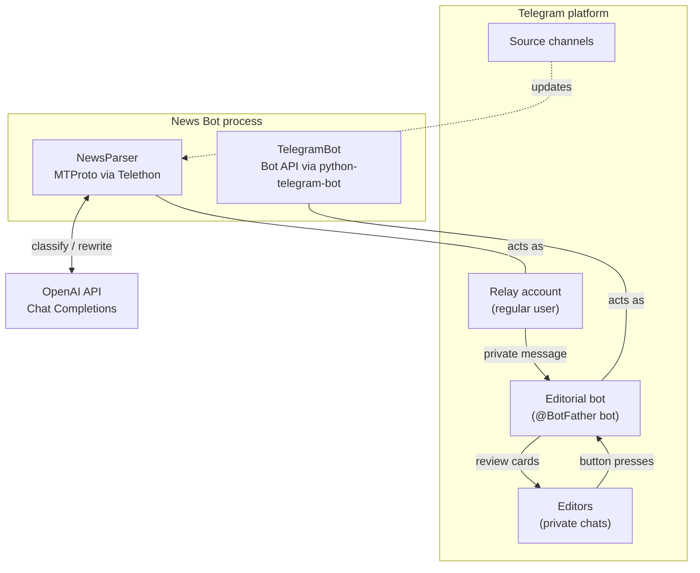
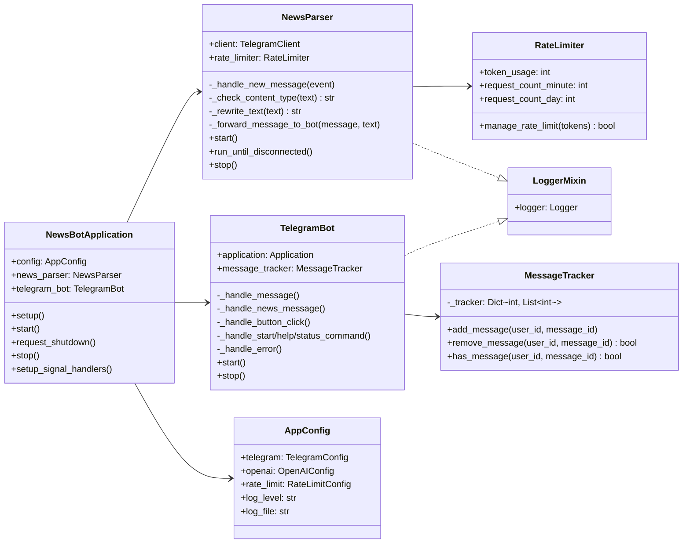
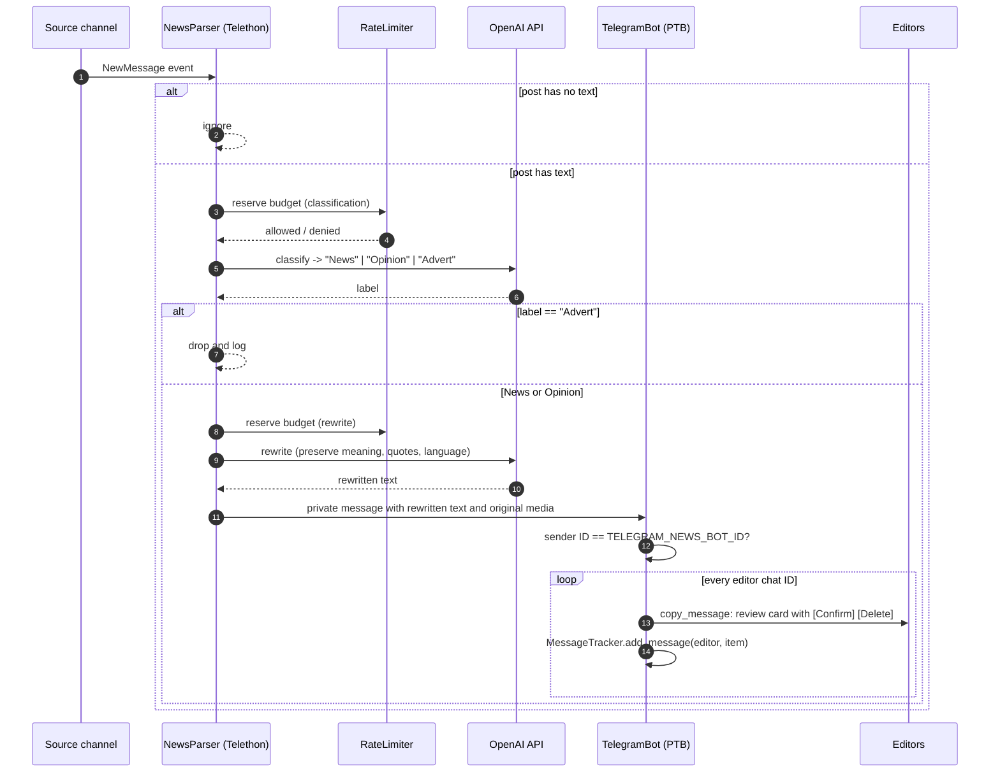
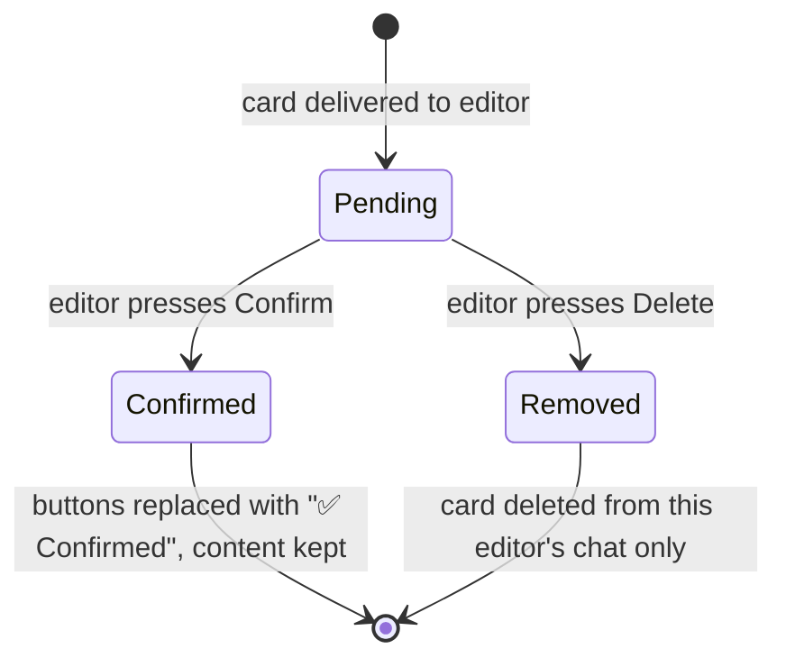

# Architecture

This document describes how News Bot is structured, how data moves through it, and why it is built the way it is.

- [System Context](#system-context)
- [Component Overview](#component-overview)
- [End-to-End Message Flow](#end-to-end-message-flow)
- [Editorial Review Flow](#editorial-review-flow)
- [Runtime and Concurrency Model](#runtime-and-concurrency-model)
- [State Management](#state-management)
- [Error Handling and Resilience](#error-handling-and-resilience)
- [Security Considerations](#security-considerations)
- [Key Design Decisions](#key-design-decisions)
- [Known Limitations](#known-limitations)
- [Extension Points](#extension-points)

---

## System Context

News Bot sits between public Telegram channels (the sources), the OpenAI API (the processing engine), and a small group of editors (the consumers). It talks to Telegram through two different APIs at the same time, each under a separate identity.

| External system        | Protocol / API                    | Identity used         | Purpose                                   |
| ---------------------- | --------------------------------- | --------------------- | ----------------------------------------- |
| Telegram (sources)     | MTProto (Telethon)                | Relay user account    | Receive posts from channels in real time |
| Telegram (editors)     | Bot API over HTTPS long polling   | Editorial bot         | Deliver review cards, handle actions     |
| OpenAI                 | REST, Chat Completions            | API key               | Classification and rewriting             |

## Component Overview

The code base is split into four packages under `src/`. Each has a single responsibility and communicates with the others only through constructor-injected configuration and Telegram itself.

### `src/main.py`: application orchestrator

`NewsBotApplication` owns the lifecycle of the whole process:

1. **Setup.** Loads `.env` from the working directory (if present), loads and validates configuration, initialises logging, and constructs both components.
2. **Start.** Connects the Telethon client, starts bot polling, and then waits until either a shutdown is requested or the Telethon client disconnects.
3. **Shutdown.** `SIGINT` and `SIGTERM` handlers set a shutdown event, which makes `start()` return and `stop()` run. A second signal forces an immediate exit. Each component is stopped independently, so a failure while stopping one does not prevent the other from shutting down.

If configuration validation fails, the process exits with a non-zero status before any network connection is opened (fail-fast).

### `src/core/`: cross-cutting concerns

- **`config.py`** defines four `dataclasses` (`TelegramConfig`, `OpenAIConfig`, `RateLimitConfig`, `AppConfig`). `load_config()` maps environment variables onto them, parses comma-separated lists, converts numeric channel IDs to integers (Telethon would otherwise treat numeric strings as phone numbers), and applies typed defaults. `validate_config()` checks that every mandatory credential is present.
- **`logger.py`** provides `setup_logger()`, which configures console and optional UTF-8 file handlers with a shared format, and `LoggerMixin`, which gives every class a logger under the application logger, named after its module and class (for example `news_bot.news_parser.news_bot.NewsParser`). Records therefore propagate to the configured handlers. The logger is resolved lazily, so classes can be instantiated before logging is configured.

### `src/news_parser/`: ingestion and AI processing

`NewsParser` wraps a Telethon `TelegramClient` and registers a `NewMessage` handler restricted to the configured channels. For every incoming post it runs the pipeline **filter → classify → rewrite → relay**. AI calls go through a shared `RateLimiter` instance that enforces request and token budgets.

Prompt design and model parameters are documented in [AI_PROCESSING.md](AI_PROCESSING.md).

### `src/bot/`: editorial interface

`TelegramBot` wraps a python-telegram-bot `Application` and registers the following handlers, in this order:

| Handler                         | Trigger                          | Behaviour                                                         |
| ------------------------------- | -------------------------------- | ----------------------------------------------------------------- |
| `CommandHandler("start")`       | `/start`                         | Welcome message                                                   |
| `CommandHandler("help")`        | `/help`                          | Feature and command overview                                      |
| `CommandHandler("status")`      | `/status`                        | Editors only: monitored channels and editors, tracked items, rate limits |
| `CallbackQueryHandler`          | Inline button press              | Handles **Confirm** and **Delete**                                |
| `MessageHandler(filters.ALL)`   | Any other message                | Routes relay messages to fan-out; replies to anyone else with a short notice |
| Error handler                   | Exception in any handler         | Logs the exception with its traceback                             |

The order matters. Within a handler group PTB runs only the first matching handler, and `filters.ALL` also matches commands, so the catch-all handler is registered last.

`MessageTracker` keeps, per editor, the IDs of items currently under review. It is used to authorise **Confirm** and **Delete** actions.

## End-to-End Message Flow

### Why the content is relayed through a private chat

The Telethon client and the bot are separate Telegram identities. The relay step (the user account sends a private message to the bot) is the integration point between them, and it was chosen deliberately:

- A **bot cannot read arbitrary channels.** It only receives posts from channels where it is an administrator, which is not possible for third-party sources. A user account can read any channel it has joined.
- A **user account cannot attach inline keyboards** to messages. Interactive review cards with callback buttons are a Bot API feature.
- **Media is re-hosted by Telegram automatically.** When the relay account sends `file=message.media`, Telegram copies the media server-side. The bot then distributes the message with `copy_message`, which keeps any media type and the text formatting, so neither side has to download or upload files.
- The bot **trusts only one sender**: messages from the user ID configured in `TELEGRAM_NEWS_BOT_ID` are treated as pipeline output, and everything else is treated as ordinary user input.

The result is a loosely coupled design. The ingestion side and the editorial side share no in-process state, and either one could be moved to a separate process or host without code changes.

## Editorial Review Flow

- Every editor receives an individual copy of the card, and review actions are independent per editor.
- Both buttons carry the item ID in their callback data (`confirm_<message_id>`, `delete_<message_id>`). Before acting, the bot checks through `MessageTracker` that the item was delivered to the user who pressed the button, and removes it from the tracker afterwards.
- **Confirm** only edits the inline keyboard, so it works the same for text and media cards and the reviewed content stays visible. Publishing approved items to a destination channel is on the [roadmap](../README.md#roadmap).

## Runtime and Concurrency Model

- **Single process, single event loop.** Both Telegram clients are `asyncio`-native and share one loop started by `asyncio.run(main())`.
- **Event-driven ingestion.** Telethon keeps a persistent MTProto connection and pushes updates. Handlers are coroutines, so several posts can be in flight at once.
- **Long polling for the bot.** python-telegram-bot's `Updater.start_polling()` runs as a background task, managed explicitly through `initialize()`, `start()`, `stop()`, and `shutdown()` instead of the blocking `run_polling()` helper. This explicit lifecycle is what makes it possible to run the bot next to Telethon in the same loop.
- **Lifecycle.** `main()` → `setup()` → `setup_signal_handlers()` → `start()` → `stop()` in a `finally` block. `start()` connects both components and then waits for whichever comes first: a shutdown request (signal) or a Telethon disconnect. Either way the process stops cleanly, and an external supervisor (Docker restart policy, systemd) can restart it.

## State Management

| State                         | Location                    | Lifetime            |
| ----------------------------- | --------------------------- | ------------------- |
| Configuration                 | `AppConfig` (immutable use) | Process             |
| Telethon session (auth keys)  | `sessions/news_bot_session.session` (SQLite), set by `TELEGRAM_SESSION_PATH` | Persistent on disk |
| Rate-limit counters           | `RateLimiter` instance      | Process             |
| Items under review per editor | `MessageTracker` dictionary | Process             |
| Logs                          | stdout and `LOG_FILE`       | Persistent (file)   |

Telegram itself is the system of record for content. The application keeps no copy of posts, so it stays stateless apart from the session file.

## Error Handling and Resilience

The pipeline is designed to degrade gracefully instead of stopping:

| Failure                                   | Behaviour                                                               |
| ----------------------------------------- | ----------------------------------------------------------------------- |
| Missing mandatory configuration           | Fail fast at startup with a clear message and exit code 1              |
| OpenAI error during classification        | Logged; post treated as `News` (fail-open, so no content is lost)      |
| OpenAI error or empty reply during rewrite | Logged; original text forwarded unchanged                              |
| Rate budget exhausted                     | AI step skipped immediately (no blocking); same fallbacks as above      |
| Relay to bot fails                        | Logged; the listener keeps processing subsequent posts                  |
| Delivery to one editor fails              | Logged; delivery to the remaining editors continues                     |
| Unhandled exception in a bot handler      | Logged with traceback by the bot's error handler; polling continues     |
| Telethon client disconnects or fails      | Logged; the application shuts down cleanly so the supervisor can restart it |
| Error while stopping a component          | Logged; the other component is still stopped                            |

Classification fails **open** on purpose. For an editorial tool, letting a questionable post through to human review is cheaper than silently losing news.

## Security Considerations

- **Secrets via environment only.** Credentials are injected through environment variables or Compose `env_file`. `.env`, session files, and logs are excluded from version control.
- **Session file is a credential.** The Telethon `.session` file grants full access to the relay account and must be protected like a password. Using a dedicated account for the relay is recommended.
- **Trusted-sender check.** Only messages from `TELEGRAM_NEWS_BOT_ID` are fanned out to editors, so other users cannot inject content into the review queue.
- **Per-editor authorisation for review actions.** **Confirm** and **Delete** are honoured only for items delivered to the requesting editor. `/status`, which reveals configuration details, is restricted to editors.
- **Least-privilege container.** The Docker image runs as an unprivileged `newsbot` user, with CPU and memory limits set in Compose.
- **Prompt injection.** Source text is embedded in prompts, so a crafted post could try to steer the model. The impact is limited by design: model output is never executed and always goes through human review.

## Key Design Decisions

| Decision                                         | Rationale                                                                                   |
| ------------------------------------------------ | ------------------------------------------------------------------------------------------- |
| Two Telegram identities (MTProto user and bot)   | The only way to combine unrestricted channel access with interactive inline UI             |
| Relay through a private chat                     | Zero shared state, server-side media copy, simple trust boundary                           |
| Human-in-the-loop instead of auto-publishing     | AI rewriting can introduce errors; editors stay accountable for what gets published        |
| Two small prompts instead of one large prompt    | Cheap, deterministic classification (`max_tokens=10`, `temperature=0`) before paying for a rewrite |
| Fail-open classification, pass-through rewrite   | Availability of content matters more than perfect filtering                                |
| Non-blocking rate limiter                        | A full budget never stalls the event loop or delays the bot's responsiveness               |
| Environment-only configuration with dataclasses  | Twelve-factor friendly, typed access, trivial to construct in tests                         |
| Model name configurable                          | Lets operators trade cost against quality without code changes                              |
| Single process, single event loop                | Minimal operational footprint for a small editorial team                                    |

## Known Limitations

- **In-memory state.** `MessageTracker` and rate-limit counters reset on restart, so **Confirm** and **Delete** on cards delivered before a restart are rejected. The daily request counter only resets when the process restarts.
- **Synchronous OpenAI calls.** The module-level `openai.chat.completions.create` client is synchronous, so each call blocks the event loop for its duration. `AsyncOpenAI` would remove this.
- **Approximate token accounting.** Token usage is estimated as 1.5 × the number of words in the prompt and does not include completion tokens.
- **Throughput.** Every post costs two requests. With the default budget of 3 requests per minute, sustained throughput is about 1.5 fully processed posts per minute. Further posts are forwarded without rewriting until the window resets.
- **Exact-match label parsing.** Only the exact string `Advert` is filtered. `Opinion` posts are currently forwarded, and variations such as `Advert.` are not recognised.
- **Text posts only.** Posts without text (for example a bare photo) are ignored. Albums are processed per message.
- **Telegram limits.** Media captions are limited to 1,024 characters and messages to 4,096. Long rewrites are not split.

## Extension Points

| Goal                                   | Where to change                                                                                  |
| -------------------------------------- | ------------------------------------------------------------------------------------------------ |
| New editor action (button)             | Add a button in `TelegramBot._review_keyboard` and a branch in `_handle_button_click`           |
| New bot command                        | Register a `CommandHandler` in `TelegramBot._setup_handlers`, before the catch-all handler       |
| New AI processing step                 | Add a method to `NewsParser` that reuses `RateLimiter`, and call it from `_handle_new_message`   |
| Different filtering policy             | Adjust the label check in `NewsParser._handle_new_message`                                       |
| Auto-publishing on Confirm             | Send the card content to a target channel from the `confirm` branch of `_handle_button_click`   |
| Persistent state                       | Replace `MessageTracker` with a repository class that keeps the same interface                   |
| New setting                            | Add a field to the relevant dataclass and read it in `load_config()`                             |
