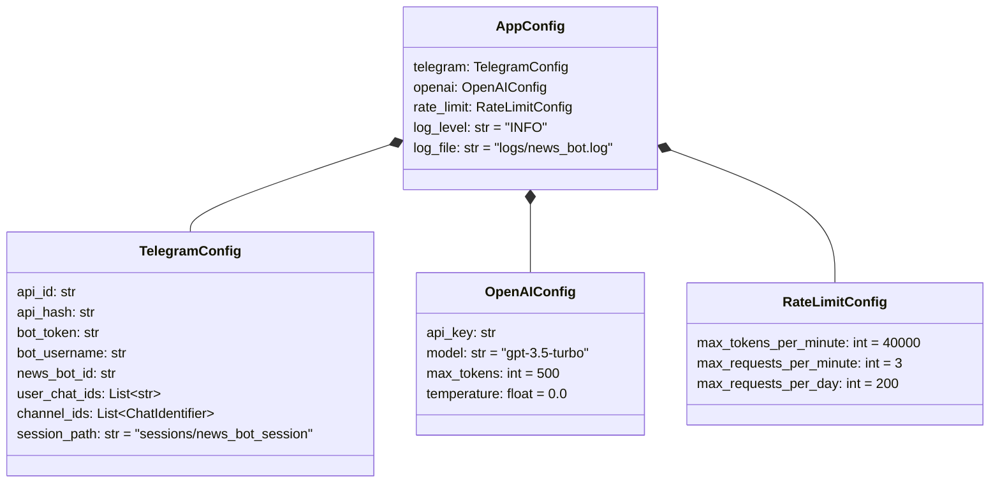

# Configuration

News Bot is configured entirely through environment variables. At startup, `core.config.load_config()` maps them onto typed dataclasses and `core.config.validate_config()` checks that all mandatory values are present. If any are missing, the process exits before it connects to anything.

- [Loading Configuration](#loading-configuration)
- [Variable Reference](#variable-reference)
- [Obtaining Credentials and IDs](#obtaining-credentials-and-ids)
- [Configuration Model](#configuration-model)
- [Example Profiles](#example-profiles)
- [Validation and Troubleshooting](#validation-and-troubleshooting)

---

## Loading Configuration

Start from the template:

```bash
cp .env.example .env
```

How the values reach the process depends on how you run it:

| Run mode            | How `.env` is applied                                                      |
| ------------------- | -------------------------------------------------------------------------- |
| Local process       | Loaded at startup from the working directory with python-dotenv            |
| Docker Compose      | Injected through `env_file: .env` in `docker-compose.yml`                  |
| `docker run`        | `docker run --env-file .env ...`                                           |

Variables already set in the environment (for example by a CI system or an orchestrator) take precedence over values in `.env`.

## Variable Reference

### Telegram: MTProto user client (ingestion)

| Variable               | Required | Default | Description                                                                 |
| ---------------------- | :------: | ------- | --------------------------------------------------------------------------- |
| `TELEGRAM_API_ID`      | yes      |         | Numeric API ID of the application registered at my.telegram.org            |
| `TELEGRAM_API_HASH`    | yes      |         | API hash of the same application                                            |
| `TELEGRAM_CHANNEL_IDS` | recommended | empty | Comma-separated source channels: public usernames (`@channel`) or numeric IDs with the `-100` prefix |
| `TELEGRAM_SESSION_PATH` | no      | `sessions/news_bot_session` | Path of the Telethon session file (`.session` is appended); the directory is created automatically |

### Telegram: Bot API (editorial interface)

| Variable                 | Required | Default | Description                                                                        |
| ------------------------ | :------: | ------- | ---------------------------------------------------------------------------------- |
| `TELEGRAM_BOT_TOKEN`     | yes      |         | Token issued by @BotFather                                                         |
| `TELEGRAM_BOT_USERNAME`  | yes      |         | The bot's username (for example `@my_news_review_bot`); the relay target           |
| `TELEGRAM_NEWS_BOT_ID`   | yes      |         | Numeric user ID of the relay account (the account behind the MTProto client)       |
| `TELEGRAM_USER_CHAT_IDS` | recommended | empty | Comma-separated numeric chat IDs of editors who receive review cards              |

### OpenAI

| Variable             | Required | Default         | Description                                             |
| -------------------- | :------: | --------------- | ------------------------------------------------------- |
| `OPENAI_API_KEY`     | yes      |                 | Secret API key                                          |
| `OPENAI_MODEL`       | no       | `gpt-3.5-turbo` | Chat Completions model used for both AI stages          |
| `OPENAI_MAX_TOKENS`  | no       | `500`           | Output token cap for rewrites (classification uses 10)  |
| `OPENAI_TEMPERATURE` | no       | `0.0`           | Sampling temperature for rewrites (classification uses 0) |

### Rate limiting

| Variable                  | Required | Default | Description                                    |
| ------------------------- | :------: | ------- | ---------------------------------------------- |
| `MAX_REQUESTS_PER_MINUTE` | no       | `3`     | Maximum OpenAI requests per rolling minute     |
| `MAX_TOKENS_PER_MINUTE`   | no       | `40000` | Maximum estimated prompt tokens per minute     |
| `MAX_REQUESTS_PER_DAY`    | no       | `200`   | Daily cap on OpenAI requests (the counter resets when the process restarts) |

### Logging

| Variable    | Required | Default        | Description                                                         |
| ----------- | :------: | -------------- | ------------------------------------------------------------------- |
| `LOG_LEVEL` | no       | `INFO`         | `DEBUG`, `INFO`, `WARNING`, `ERROR`, or `CRITICAL`                  |
| `LOG_FILE`  | no       | `logs/news_bot.log` | Log file path; parent directories are created automatically   |

The defaults for `TELEGRAM_SESSION_PATH` and `LOG_FILE` point to `sessions/` and `logs/`, which are the volumes mounted by `docker-compose.yml`.

## Obtaining Credentials and IDs

### `TELEGRAM_API_ID` and `TELEGRAM_API_HASH`

1. Sign in at [my.telegram.org](https://my.telegram.org/apps) with the phone number of the relay account.
2. Open **API development tools** and create an application.
3. Copy the `api_id` and `api_hash`.

A dedicated Telegram account for the relay is recommended. It must join every source channel.

### `TELEGRAM_BOT_TOKEN` and `TELEGRAM_BOT_USERNAME`

1. Open a chat with [@BotFather](https://t.me/BotFather) and send `/newbot`.
2. Choose a display name and a username ending in `bot`.
3. Copy the token. The username is the value for `TELEGRAM_BOT_USERNAME`.

### `TELEGRAM_NEWS_BOT_ID`

This is the numeric **user ID of the relay account**. From that account, message [@userinfobot](https://t.me/userinfobot) and copy the ID it returns. The bot only fans out messages from this sender.

### `TELEGRAM_USER_CHAT_IDS`

1. Each editor messages [@userinfobot](https://t.me/userinfobot) to get their numeric ID.
2. Each editor must open the editorial bot and press **Start** once. Telegram does not allow bots to start conversations with users.

### `TELEGRAM_CHANNEL_IDS`

- **Public channels:** use the username, for example `@example_news`.
- **Private channels or numeric form:** forward a post from the channel to [@getidsbot](https://t.me/getidsbot) (or a similar bot) and use the ID with the `-100` prefix, for example `-1001234567890`.

## Configuration Model



Because configuration is made of plain dataclasses, tests and scripts can build it directly without touching the environment:

```python
from core.config import AppConfig, TelegramConfig, OpenAIConfig, RateLimitConfig

config = AppConfig(
    telegram=TelegramConfig(
        api_id="12345", api_hash="hash", bot_token="token",
        bot_username="@review_bot", news_bot_id="111",
        user_chat_ids=["222"], channel_ids=["@example_news", -1001234567890],
    ),
    openai=OpenAIConfig(api_key="sk-..."),
    rate_limit=RateLimitConfig(),
)
```

## Example Profiles

**Development (verbose, cheap):**

```env
LOG_LEVEL=DEBUG
OPENAI_MODEL=gpt-3.5-turbo
MAX_REQUESTS_PER_MINUTE=3
MAX_REQUESTS_PER_DAY=200
```

**Production (paid tier, higher throughput):**

```env
LOG_LEVEL=INFO
OPENAI_MODEL=gpt-4o-mini
OPENAI_MAX_TOKENS=600
OPENAI_TEMPERATURE=0.3
MAX_REQUESTS_PER_MINUTE=60
MAX_TOKENS_PER_MINUTE=200000
MAX_REQUESTS_PER_DAY=5000
```

## Validation and Troubleshooting

`validate_config()` requires these values to be non-empty:

`TELEGRAM_API_ID`, `TELEGRAM_API_HASH`, `TELEGRAM_BOT_TOKEN`, `TELEGRAM_BOT_USERNAME`, `TELEGRAM_NEWS_BOT_ID`, `OPENAI_API_KEY`.

| Symptom                                           | Likely cause and fix                                                                 |
| ------------------------------------------------- | ------------------------------------------------------------------------------------ |
| `Configuration validation failed` at startup      | A required variable is empty or the environment was not loaded (see [Loading Configuration](#loading-configuration)) |
| `Invalid api_id ...` warning                      | `TELEGRAM_API_ID` is not numeric                                                     |
| Bot replies "Hello! I'm the news bot..." to relayed posts | `TELEGRAM_NEWS_BOT_ID` does not match the relay account's user ID             |
| Editors receive nothing                           | Wrong `TELEGRAM_USER_CHAT_IDS`, or the editor never pressed **Start** in the bot    |
| No posts are picked up                            | The relay account has not joined the channel, or the channel identifier is wrong    |
| `Rate limit reached` warnings                     | Budget exhausted; raise the `MAX_*` limits to match your OpenAI tier                |
| `ValueError` on startup for a numeric setting     | A non-numeric value in `OPENAI_MAX_TOKENS`, `OPENAI_TEMPERATURE`, or `MAX_*`        |
