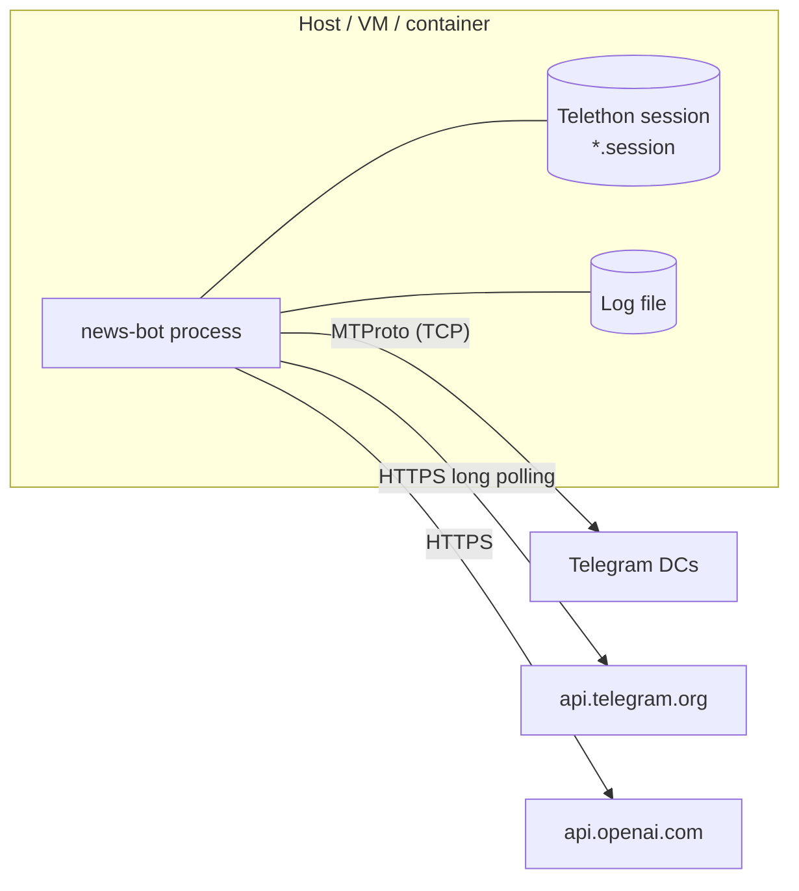

# Deployment

This guide covers running News Bot locally, in Docker, and with Docker Compose, plus first-time Telegram authentication and day-to-day operations.

- [Deployment Topology](#deployment-topology)
- [Prerequisites](#prerequisites)
- [First-Time Telegram Authentication](#first-time-telegram-authentication)
- [Option A: Local Python Process](#option-a-local-python-process)
- [Option B: Docker Compose](#option-b-docker-compose)
- [Option C: Plain Docker](#option-c-plain-docker)
- [Container Image](#container-image)
- [Operations](#operations)
- [Production Checklist](#production-checklist)

---

## Deployment Topology

News Bot runs as **one long-lived process** that opens only outbound connections:



- No inbound ports, webhooks, or public IP are needed.
- Run **exactly one instance** per bot token and session. Two pollers on the same bot token conflict, and two clients on the same session file can corrupt it.
- Resource needs are small: the Compose limits are 0.5 CPU and 512 MB RAM.

## Prerequisites

- Credentials and IDs as described in [CONFIGURATION.md](CONFIGURATION.md)
- The relay account has joined every source channel
- Every editor has pressed **Start** in the editorial bot
- Python 3.8+ for local runs, or Docker Engine with the Compose plugin

## First-Time Telegram Authentication

The MTProto client logs in as a real Telegram account. On the first start Telethon asks for:

1. the phone number of the relay account,
2. the login code that Telegram sends to that account,
3. the two-step verification password, if one is set.

The authorised session is stored in `sessions/news_bot_session.session` (a SQLite file; the path is configurable with `TELEGRAM_SESSION_PATH`). Later starts reuse it without prompting.

> **Treat the session file as a secret.** Anyone who has it can act as the relay account. It is excluded from version control by `.gitignore`.

Because the login is interactive, run the first start in a terminal: either locally ([Option A](#option-a-local-python-process)) or with `docker compose run` ([Option B](#option-b-docker-compose)). If you abort the login prompt with `Ctrl+C`, press it a second time to force the exit.

## Option A: Local Python Process

```bash
git clone https://github.com/n0ah-n0wa/news_bot.git
cd news_bot

python -m venv .venv
source .venv/bin/activate          # Windows: .venv\Scripts\activate
pip install -e .

cp .env.example .env               # fill in the values; loaded automatically

python -m src.main
```

Expected startup log:

```text
... - news_bot - INFO - 🚀 Starting News Bot Application
... - news_bot - INFO - ✅ Application setup completed
... - news_bot - INFO - 🔄 Starting application components...
... - news_bot.news_parser.news_bot.NewsParser - INFO - Starting news parser...
... - news_bot.news_parser.news_bot.NewsParser - INFO - News parser connected, monitoring 3 channel(s)
... - news_bot.bot.telegram_bot.TelegramBot - INFO - Starting Telegram bot...
... - news_bot - INFO - ✅ All components are running
```

Stop with `Ctrl+C`. The application catches the signal, shuts both components down, and exits.

For an always-on host without containers, run the same command under a process supervisor such as systemd:

```ini
# /etc/systemd/system/news-bot.service
[Unit]
Description=News Bot
After=network-online.target

[Service]
WorkingDirectory=/opt/news_bot
EnvironmentFile=/opt/news_bot/.env
ExecStart=/opt/news_bot/.venv/bin/python -m src.main
Restart=on-failure
User=newsbot

[Install]
WantedBy=multi-user.target
```

## Option B: Docker Compose

`docker-compose.yml` defines a single `news-bot` service with:

- `env_file: .env` for configuration
- `restart: unless-stopped`
- bind mounts `./logs:/app/logs` and `./sessions:/app/sessions`
- a liveness health check
- CPU and memory limits and reservations

### 1. Prepare configuration and volumes

```bash
cp .env.example .env               # fill in the values
mkdir -p logs sessions
```

On Linux hosts, the container's unprivileged `newsbot` user must be able to write to both folders. Check its UID with `docker compose run --rm news-bot id -u` (usually `1000`) and run `sudo chown -R <uid>:<uid> logs sessions`.

### 2. Log in to Telegram once

```bash
docker compose run --rm news-bot
```

Enter the phone number, login code, and (if set) the two-step verification password. The session is written to `./sessions/` on the host. When the log shows `All components are running`, press `Ctrl+C`. Later starts reuse the session without prompting.

If you already have a session file from a local run, copy it to `./sessions/` instead.

### 3. Build and start

```bash
docker compose up -d --build
docker compose ps
docker compose logs -f news-bot
```

### 4. Update to a new version

```bash
git pull
docker compose up -d --build
```

### 5. Stop

```bash
docker compose down
```

`docker compose down` sends `SIGTERM`, which the application handles as a graceful shutdown.

## Option C: Plain Docker

```bash
docker build -t news-bot .

docker run -d --name news-bot \
  --env-file .env \
  -v "$(pwd)/logs:/app/logs" \
  -v "$(pwd)/sessions:/app/sessions" \
  --restart unless-stopped \
  news-bot
```

## Container Image

| Property          | Value                                                                  |
| ----------------- | ---------------------------------------------------------------------- |
| Base image        | `python:3.11-slim`                                                     |
| Working directory | `/app`                                                                 |
| Python path       | `PYTHONPATH=/app/src`                                                  |
| Output buffering  | `PYTHONUNBUFFERED=1`, so logs appear in `docker logs` immediately      |
| Build tools       | `gcc` for building native wheels where needed                          |
| Dependencies      | Installed from `pyproject.toml`, with `requirements.txt` as a fallback |
| Runtime user      | Unprivileged `newsbot`                                                 |
| Prepared folders  | `/app/logs`, `/app/sessions`                                           |
| Entry point       | `python -m src.main`                                                   |
| Health check      | Interpreter liveness every 30 s                                        |

## Operations

### Logging

- Every component logs to **stdout**, so `docker compose logs` and `journalctl` work, and to the file in `LOG_FILE`.
- Logger names show where a record came from: `news_bot` (orchestrator), `news_bot.news_parser.news_bot.NewsParser` (ingestion and AI), `news_bot.bot.telegram_bot.TelegramBot` (editorial bot).
- Set `LOG_LEVEL=DEBUG` for troubleshooting.
- The application does not rotate its log file. Use `logrotate` on the host or Docker's `json-file` options (`max-size`, `max-file`) for log retention.

Useful signals in the logs:

| Log message                               | Meaning                                         |
| ----------------------------------------- | ----------------------------------------------- |
| `Message received: ...`                   | A post arrived from a monitored channel         |
| `Content type determined: <label>`        | Classification result                           |
| `Skipping message of type: Advert`        | Post filtered out                               |
| `Text rewritten successfully`             | Rewrite completed                               |
| `Rate limit reached, ...`                 | AI step skipped because the budget is exhausted |
| `Message successfully forwarded to bot`   | Relay step completed                            |
| `Message forwarded to user <id>`          | Review card delivered to an editor              |
| `Error while handling update: ...`        | A bot handler raised an exception (traceback follows) |
| `Telegram client disconnected/failed ...` | The listener stopped; the process exits and the restart policy brings it back |

### Backups

The only state worth backing up is the **Telethon session file** in `sessions/`. Configuration lives in `.env` and should be kept in a secret manager. Review state is kept in memory and is reset on restart; cards that were already delivered stay in the editors' chats.

### Monitoring

`docker-compose.yml` contains a commented-out Prometheus service as a starting point for metrics collection. For basic uptime, Compose's restart policy together with log-based alerting on `ERROR` records is usually enough for a single-instance deployment.

## Production Checklist

- [ ] Dedicated Telegram account for the relay, with two-step verification enabled
- [ ] `.env` and the session file stored outside version control, with restrictive permissions
- [ ] OpenAI usage limits set in the OpenAI dashboard as well as through `MAX_*`
- [ ] `logs/` and `sessions/` are persistent and writable by the container user, and log rotation is configured
- [ ] Exactly one running instance per bot token and session
- [ ] All editors have started the bot and their IDs are in `TELEGRAM_USER_CHAT_IDS`
- [ ] Restart policy or supervisor configured (`unless-stopped` or systemd `Restart=on-failure`)
