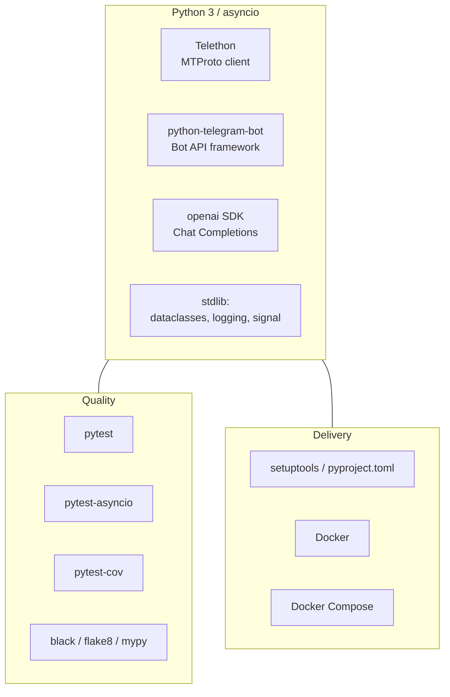

# Technology Stack

This document lists every technology used in News Bot, what it is responsible for, and why it was selected.

- [Summary](#summary)
- [Runtime](#runtime)
- [Telegram Integration](#telegram-integration)
- [Artificial Intelligence](#artificial-intelligence)
- [Configuration and Logging](#configuration-and-logging)
- [Testing and Quality](#testing-and-quality)
- [Packaging and Deployment](#packaging-and-deployment)
- [Dependency Matrix](#dependency-matrix)

---

## Summary

| Category          | Technology                                     |
| ----------------- | ---------------------------------------------- |
| Language          | Python 3.8+ (`asyncio`, type hints, `dataclasses`) |
| Telegram (user)   | Telethon, MTProto API                          |
| Telegram (bot)    | python-telegram-bot v20+, Bot API              |
| AI provider       | OpenAI, Chat Completions API                   |
| Default model     | `gpt-3.5-turbo` (configurable via `OPENAI_MODEL`) |
| Testing           | pytest, pytest-asyncio, pytest-cov, `unittest.mock` |
| Code quality      | black, flake8, mypy (`dev` extra)              |
| Packaging         | setuptools via `pyproject.toml` (PEP 621)      |
| Containerisation  | Docker (`python:3.11-slim`), Docker Compose    |

## Runtime

### Python 3 with `asyncio`

The whole application runs on one `asyncio` event loop. Both Telegram libraries are natively asynchronous, so a single process can keep an MTProto connection open, long-poll the Bot API, and handle many updates concurrently without threads.

Language features in use:

- `async`/`await` coroutines for every I/O-bound handler
- `asyncio.Event` and `asyncio.wait` to run until a shutdown request or a client disconnect
- Type hints throughout (`typing.List`, `Dict`, `Optional`)
- `dataclasses` for configuration objects
- `signal` handlers for graceful shutdown on `SIGINT` and `SIGTERM`
- `pathlib` for file system paths

**Supported versions:** Python 3.8 or newer (`requires-python = ">=3.8"`). The container image uses Python 3.11. The test suite has also been run on Python 3.13.

## Telegram Integration

The project uses two Telegram APIs on purpose, because each one covers something the other cannot (see [ARCHITECTURE.md](ARCHITECTURE.md#why-the-content-is-relayed-through-a-private-chat)).

### Telethon (`telethon>=1.28.0`)

Asynchronous client for Telegram's native **MTProto** protocol, authenticated as a regular user account.

| Used for                          | API surface                                          |
| --------------------------------- | ---------------------------------------------------- |
| Persistent connection and session | `TelegramClient(session_path, api_id, api_hash)`, `await client.start()` |
| Lifecycle monitoring              | `client.run_until_disconnected()`, `client.disconnect()` |
| Real-time channel updates         | `@client.on(events.NewMessage(chats=[...]))`         |
| Resolving the bot by username     | `client.get_entity(username)`                        |
| Relaying text with original media | `client.send_message(entity, text, file=message.media)` |

**Why Telethon:** it reads any channel the account has joined without admin rights, receives updates by push instead of polling, and can forward media by reference so no files pass through the host.

### python-telegram-bot (`python-telegram-bot>=20.0`)

Asynchronous framework for the official **Bot API**.

| Used for                      | API surface                                                          |
| ----------------------------- | -------------------------------------------------------------------- |
| Application lifecycle         | `Application.builder().token(...).build()`, `initialize/start/stop/shutdown` |
| Receiving updates             | `Updater.start_polling()` (long polling)                             |
| Routing                       | `CommandHandler`, `CallbackQueryHandler`, `MessageHandler(filters.ALL)`, error handler |
| Interactive review UI         | `InlineKeyboardMarkup`, `InlineKeyboardButton`, callback data        |
| Delivering content            | `copy_message` (any media type, formatting preserved), `reply_text` with HTML parse mode |
| Acting on review decisions    | `CallbackQuery.answer`, `edit_message_reply_markup`, `delete_message` |

**Why python-telegram-bot:** it is a mature and well-documented Bot API framework. Version 20 and later are fully `asyncio`-based, which allows explicit lifecycle control so the bot can share an event loop with Telethon.

## Artificial Intelligence

### OpenAI Python SDK (`openai>=1.0.0`)

| Aspect             | Detail                                                                 |
| ------------------ | ---------------------------------------------------------------------- |
| Endpoint           | Chat Completions (`openai.chat.completions.create`)                    |
| Default model      | `gpt-3.5-turbo`                                                        |
| Model selection    | Any Chat Completions model, set with `OPENAI_MODEL`                    |
| Tasks              | 1) content classification, 2) content rewriting                         |
| Authentication     | `OPENAI_API_KEY`                                                       |
| Cost controls      | Per-minute request and token budget, daily request cap, small `max_tokens` for classification |

**Why OpenAI / GPT-3.5 Turbo:** high-quality multilingual rewriting at low cost per request and low latency, which suits a high-volume pipeline where each post needs two calls. The model name is configurable, so newer or cheaper models can be used without code changes.

Prompt design, parameters, and failure handling are covered in [AI_PROCESSING.md](AI_PROCESSING.md).

## Configuration and Logging

| Component                 | Technology                     | Notes                                                    |
| ------------------------- | ------------------------------ | -------------------------------------------------------- |
| Configuration model       | `dataclasses`                  | `TelegramConfig`, `OpenAIConfig`, `RateLimitConfig`, `AppConfig` |
| Configuration source      | Environment variables (`os.getenv`) | Twelve-factor style; real environment variables take precedence |
| `.env` loading            | `python-dotenv>=1.0.0`         | Loads `.env` from the working directory at startup       |
| Logging                   | `logging` (standard library)   | Console and UTF-8 file handlers, shared formatter        |
| Per-class loggers         | `LoggerMixin`                  | Hierarchical logger names (`module.Class`)               |

## Testing and Quality

| Tool              | Version   | Role                                                                    |
| ----------------- | --------- | ----------------------------------------------------------------------- |
| pytest            | `>=7.0`   | Test runner and fixtures                                                |
| pytest-asyncio    | `>=0.21`  | Running `async def` tests (`@pytest.mark.asyncio`)                      |
| pytest-cov        | `>=4.0`   | Coverage reports (`--cov=src`)                                          |
| `unittest.mock`   | stdlib    | Patching `TelegramClient`, `Application`, and OpenAI calls              |
| black             | `>=23.0`  | Code formatting                                                         |
| flake8            | `>=6.0`   | Linting                                                                 |
| mypy              | `>=1.5`   | Static type checking                                                    |

All external services are mocked, so tests run offline and need no credentials. See [DEVELOPMENT.md](DEVELOPMENT.md#testing-strategy).

## Packaging and Deployment

| Tool                    | Role                                                                                  |
| ----------------------- | ------------------------------------------------------------------------------------- |
| `pyproject.toml` (PEP 621) | Project metadata, runtime dependencies, `test` and `dev` extras, src layout        |
| setuptools + wheel      | Build backend; editable installs with `pip install -e .`                              |
| `requirements.txt`      | Flat list of runtime dependencies for simple installs                                 |
| Docker                  | `python:3.11-slim` image, non-root user, `PYTHONUNBUFFERED`, health check            |
| Docker Compose          | `restart: unless-stopped`, `env_file`, volumes for logs and sessions, CPU/memory limits |

Deployment procedures are described in [DEPLOYMENT.md](DEPLOYMENT.md).

## Dependency Matrix

| Package               | Declared constraint | Verified with | Scope    |
| --------------------- | ------------------- | ------------- | -------- |
| python-telegram-bot   | `>=20.0`            | 22.5          | runtime  |
| telethon              | `>=1.28.0`          | 1.41.2        | runtime  |
| openai                | `>=1.0.0`           | 2.3.0         | runtime  |
| python-dotenv         | `>=1.0.0`           | 1.1.1         | runtime  |
| pytest                | `>=7.0.0`           | 8.4.2         | test/dev |
| pytest-asyncio        | `>=0.21.0`          | 1.2.0         | test/dev |
| pytest-cov            | `>=4.0.0`           | n/a           | test/dev |
| black                 | `>=23.0.0`          | n/a           | dev      |
| flake8                | `>=6.0.0`           | n/a           | dev      |
| mypy                  | `>=1.5.0`           | n/a           | dev      |

"Verified with" lists the versions the test suite was last run against.
